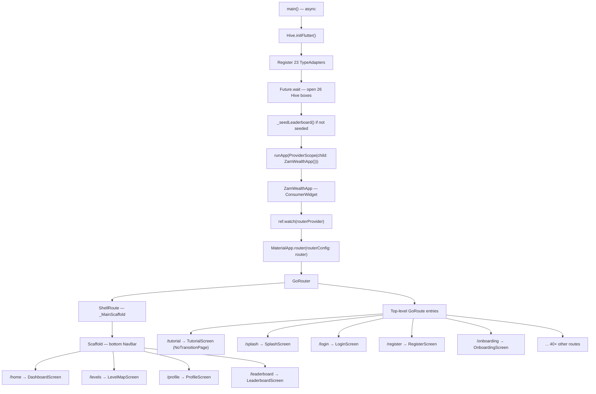

# Architecture

## Overview

ZamWealth Quest is a single-process Flutter application with no backend. All data lives in Hive boxes on-device. State is managed exclusively through Riverpod providers. Navigation is handled by go_router with a `GoRouter` instance exposed as `routerProvider`.

---

## Widget Tree



---

## Startup Sequence

`main()` is fully async. The app will not call `runApp()` until all Hive adapters are registered and all 26 boxes are open. This prevents any screen from reading a box that has not yet been initialized.

```dart
// main.dart startup order
void main() async {
  WidgetsFlutterBinding.ensureInitialized();
  await Hive.initFlutter();
  _registerAdapters();          // 23 TypeAdapters
  await Future.wait([...]);     // open 26 boxes in parallel
  await _seedLeaderboard();     // one-time fake player seed
  runApp(const ProviderScope(child: ZamWealthApp()));
}
```

---

## ProviderScope

`ProviderScope` is the root of the widget tree. It has no overrides and no observers configured. All Riverpod providers are global (not scoped). Any screen anywhere in the tree can call `ref.watch()` or `ref.read()` on any provider.

---

## MaterialApp.router

```dart
MaterialApp.router(
  routerConfig: router,        // from ref.watch(routerProvider)
  theme: zamWealthTheme,
  builder: (context, child) => child ?? const SizedBox.shrink(),
  debugShowCheckedModeBanner: false,
)
```

The `builder:` pattern here is minimal — it passes the child through unchanged, with a `SizedBox.shrink()` guard for the null case. **TutorialOverlayHost was removed from this builder.** See the architectural lesson below.

---

## ShellRoute and Bottom Navigation

The `ShellRoute` wraps the four main tabs:

- `/home` — DashboardScreen
- `/levels` — LevelMapScreen
- `/profile` — ProfileScreen
- `/leaderboard` — LeaderboardScreen

The shell builder returns `_MainScaffold`, which wraps `child` with a persistent `BottomNavigationBar` (`_NavBar`). The current tab index is computed from the current route location using prefix matching — e.g., a location starting with `/levels` activates tab index 1.

**Tabs use `context.go()`**, not `Navigator.push()`. This replaces the current stack entry rather than pushing, keeping back-button behavior sensible.

---

## TutorialScreen as a Top-Level Route

`/tutorial` is a **top-level GoRoute** — it is NOT inside the ShellRoute. This means:

- The bottom navigation bar is NOT visible on the tutorial screen.
- The screen covers the entire display, including the nav bar area.
- It uses `NoTransitionPage` for an instant, non-animated appearance.

This design was arrived at after debugging (see [Bug 17 in bug-history.md](bug-history.md)). The tutorial was originally implemented as a dialog opened from inside the dashboard build method, which caused silent failures.

---

## Architectural Lesson: GoRouterState.of(context) in builder:

**Never call `GoRouterState.of(context)` from the `MaterialApp.router` builder context.**

The `builder:` function receives a `BuildContext` that is a sibling of the router's child subtree — it is not a descendant of the GoRouter's `InheritedWidget`. Calling `GoRouterState.of(context)` from there throws a `ProviderNotFoundException` equivalent (no GoRouter InheritedWidget ancestor found).

The original `TutorialOverlayHost` widget attempted to read the router state from the builder context. This was the root cause of the app freeze described in Bug 16. The fix was to remove all navigation logic from the builder and use a dedicated route instead.

**Rule:** Any widget that needs to call `context.go()`, `context.push()`, or read `GoRouterState.of(context)` must be placed inside the router child tree — a Screen widget, not a wrapper in `builder:`.

---

## The 5 Architectural Rules

These rules must never be violated. Every past bug in this codebase can be traced to breaking one of them.

| # | Rule | Reason |
|---|---|---|
| 1 | **No network calls — 100% offline** | The app targets users with limited connectivity. All data is pre-bundled or generated locally. |
| 2 | **All state via Riverpod only** | Direct Hive reads inside build methods bypass Riverpod's reactivity, causing stale UI. |
| 3 | **All Hive writes must be awaited before navigation** | Navigating away before a write completes can corrupt box state on app restart. |
| 4 | **All navigation via go_router only** | `Navigator.push()` bypasses the redirect logic in `routerProvider` and breaks the auth guard. |
| 5 | **Always check `context.mounted` after async gaps** | Flutter disposes widgets during async operations. Using an unmounted context crashes the app. |
